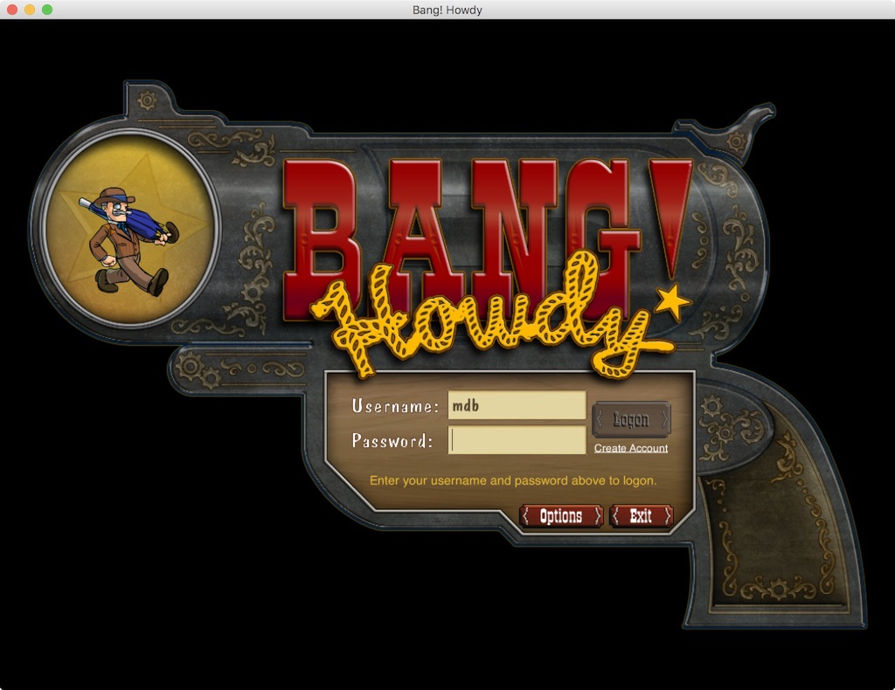

# Bang! Howdy Pardner

Herein lies the source code to the game Bang! Howdy. This is a game that was created by Three Rings
Design in 2004 and which is still limping along at http://www.banghowdy.com/

This fork modernizes the game to run on current tooling: it builds with **Gradle 8.14** on a
**JDK 21** toolchain and runs against **MySQL 8** (Connector/J 8, with the legacy schema migrations
fixed up for MySQL 8's reserved words). The rendering has been cut over from the vendored 2005-era
jMonkeyEngine fork (LWJGL 2.9 + [libGDX]) to stock [jMonkeyEngine 3.9] on LWJGL3 — the running
client, server, and editor ship and load **zero fork code**. (The old `jme` fork module survives
only as a build-time model/particle asset compiler, whose removal is deferred to a later epic.)
See `docs/epics.md` and `docs/jme3-cutover-plan.md` for the cutover plan and status. The in-game
board/map editor has also been fixed up and runs again.

The client, server, and editor all build and run locally. Here's how.

## Building and running

The game builds with the included [Gradle] wrapper (Gradle 8.14) on a JDK 21 toolchain — the
wrapper and toolchain provisioning mean no other JDK or Gradle install is needed:

```
./gradlew deploy
```

which will build everything, process all the resources and prepare things to be run locally.

Assuming that worked, you'll have a `build/client` and `build/server/` directory with a bunch of
jar files in them (among a zillion other directories).

Next you need to copy all the `etc/*.dist` files into `etc/test/` without the `.dist` suffix. For
example, `etc/deployment.properties.dist` gets copied to `etc/test/deployment.properties`. In
theory you can edit those files to tweak the settings for your test deployment, but the defaults
are fine for now so just copy and rename.

You can now run the client, even though it will have no one to talk to:

```
./bin/bangclient
```

That should show you something like this:



Now you have the more complex task of setting up the server. When I said above that you don't need
to edit the files in `etc/test/*`, I lied. You have to edit `etc/test/server.properties` and
configure a username and password for a MySQL database which must be running somewhere (I recommend
on your local machine), which the Bang! server can use to store data.

There will be a section that looks like this:

```
#
# The default database mapping; all other definitions will inherit from
# this and need only be specified in cases where they differ from the
# defaults

db.default.driver = com.mysql.cj.jdbc.Driver
db.default.url = jdbc:mysql://DBHOST:3306/bang?serverTimezone=UTC
db.default.username = USERNAME
db.default.password = PASSWORD

# These overrides are needed for the OOO user database
db.userdb.url = jdbc:mysql://USERDBHOST:3306/ooouser?serverTimezone=UTC
db.sitedb.url = jdbc:mysql://USERDBHOST:3306/ooouser?serverTimezone=UTC
```

You need to change `DBHOST`, `USERNAME`, `PASSWORD` to the appropriate values for your MySQL server
(and you can set `USERDBHOST` to the same value as `DBHOST` and keep that on the same server). Then
you need to create a `bang` and `ooouser` database on your MySQL server (or change those names to
database names that you prefer and which you have created). MySQL 8.0, 8.4, and 9.x all work —
the bundled Connector/J 8 driver speaks MySQL's default `caching_sha2_password` auth, so a plain
user creation is all you need:

```
CREATE DATABASE bang; CREATE DATABASE ooouser;
CREATE USER 'bang'@'localhost' IDENTIFIED BY 'yourpass';
GRANT ALL PRIVILEGES ON bang.* TO 'bang'@'localhost';
GRANT ALL PRIVILEGES ON ooouser.* TO 'bang'@'localhost';
```

Also set `server_root` in `etc/test/server.properties` to your checkout directory (audit logs and
board data resolve relative to it).

Then you can run the server like so:

```
./bin/bangserver
```

The first time you run it, it will create a bunch of database tables and eventually it should say
something along the lines of:

```
2016/12/17 18:32:40:993 INFO com.threerings.bang: Running in cluster mode as node 'frontier_town'.
2016/12/17 18:32:41:028 INFO com.threerings.bang: Bang server v0 initialized.
2016/12/17 18:32:41:029 INFO com.threerings.presents: DOMGR running.
2016/12/17 18:32:41:045 INFO com.threerings.narya: Server listening on 0.0.0.0/0.0.0.0:47624.
```

If so, you are tantalizingly close to logging into your own local Bang! Howdy instance. The only
final problem is that there are no users in the user database, so there's no one to log in as.

Not to worry, there's a gradle target that will create a test user in your pristine empty
database. Just run:

```
./gradlew server:createTestUser
```

And now you can log into your local server with username `test` and password `yeehaw`.

For development you can skip the login screen and jump straight into the action:

```
./bin/bangclient -Dusername=test -Dpassword=yeehaw            # auto-logon
./bin/bangclient -test -autoplay -Dusername=test -Dpassword=yeehaw   # straight into a game vs AI
```

The `-autoplay` mode requires the account to hold the admin token (plain `-test` does not), which
you can grant with:

```
UPDATE ooouser.users SET tokens = CHAR(1) WHERE username = 'test';
```

(The server caches session credentials across reconnects, so restart the server after granting.)

The board/map editor runs with:

```
./bin/bangeditor
```

That's about it. You can now hack on your own private Bang! Howdy instance and implement all those
features you always wanted. Good luck!

## License

The Bang! Howdy source code is released under a BSD license. The Bang! Howdy media, 3D models,
texture images, UI images, sound files, everything other than the code, is released under the
Creative Commons [Attribution-NonCommercial 3.0] license.

[libGDX]: https://libgdx.com/
[jMonkeyEngine 3.9]: https://jmonkeyengine.org/
[Gradle]: https://gradle.org/
[Attribution-NonCommercial 3.0]: https://creativecommons.org/licenses/by-nc/3.0/us/
