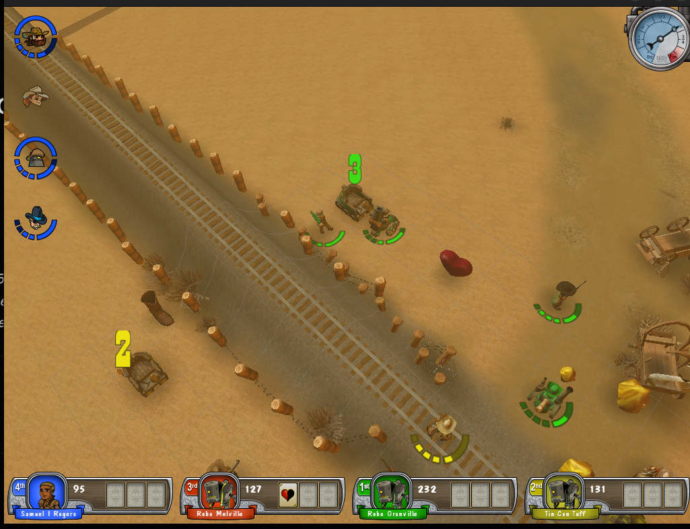
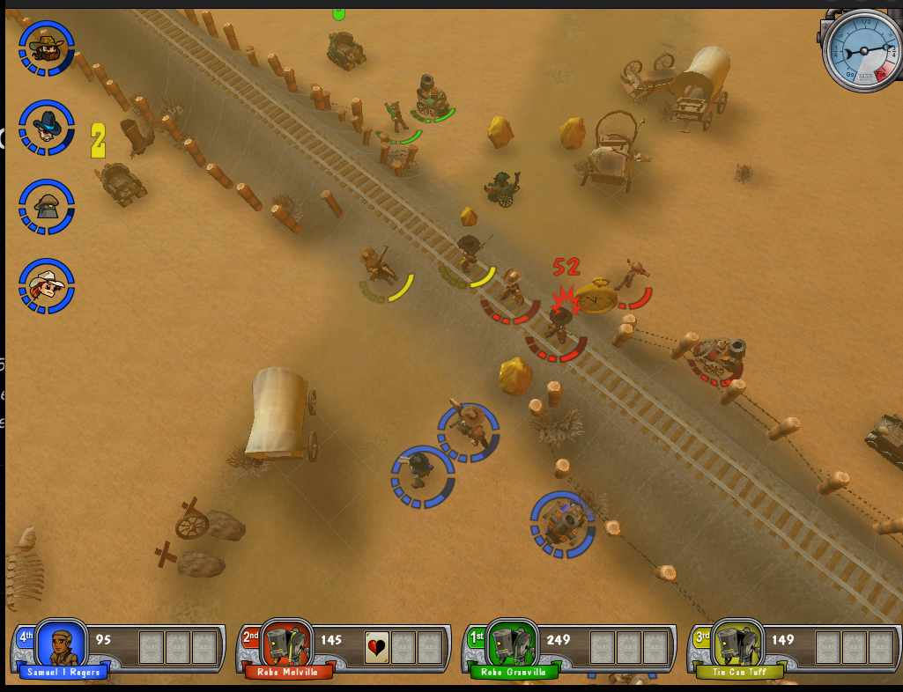
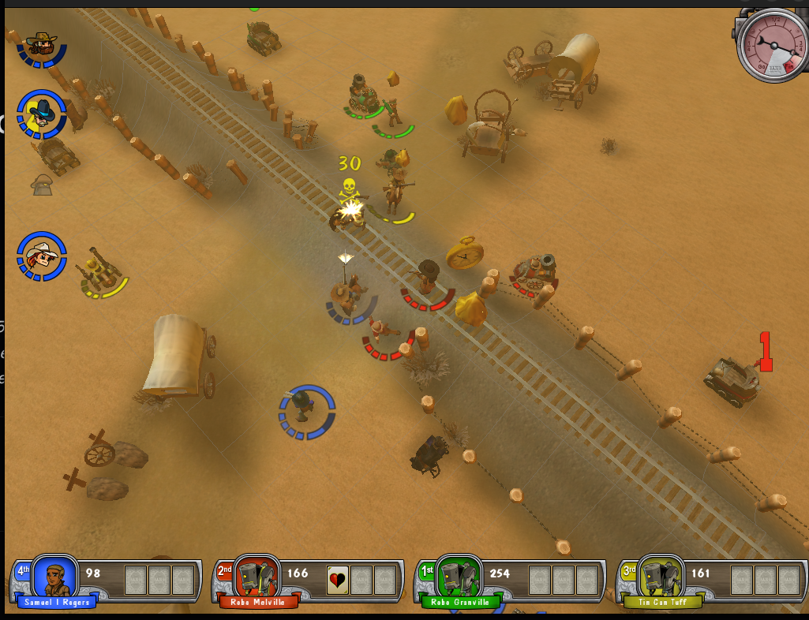
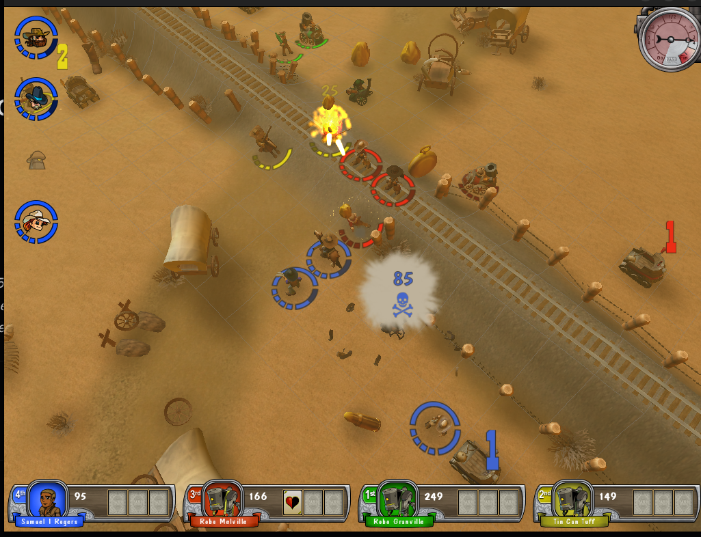
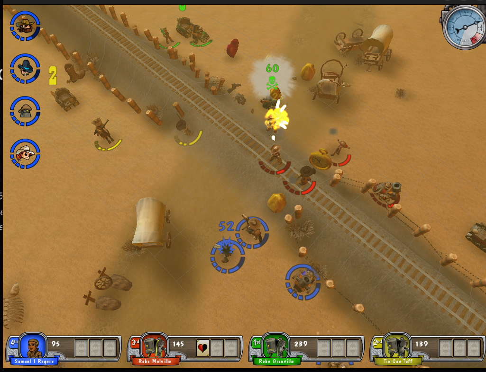
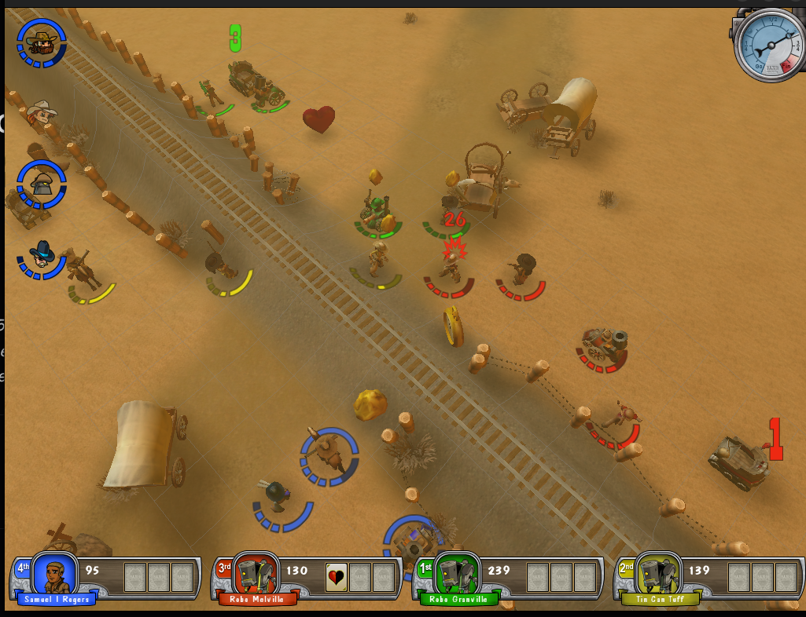

# Fidelity-reference screenshots

In-game captures the user took to show what units, effects, animations, and UI
elements **should** look like, to guide the jME3-cutover fidelity work (see
`docs/jme3-cutover-plan.md` and `docs/epics.md`).

> **PROVENANCE — CONFIRMED 2026-06-14: all six are from the OLD FORK build**
> (pre-cutover `~/Repos/Github/bang-game` master, LWJGL2/gdx). They are **correct golden
> references** — the target the jME3 conversion must match — **not** current-jME3 defect
> evidence. Disregard the per-image "current-jME3 vs fork" guesses below (incl. the
> "ambiguous" calls on `attackAndDeathAnimation` and `explosionAndDeath`): every one is a fork
> golden. The fork client is still runnable from `bang-game`/master, so more fork stills/videos
> can be captured there.

All six are clean single-window grabs (the same crop `bin/shot` produces — game
content only, no desktop / second monitor / personal content leaked in), **1025 x 786
px, RGBA**. None required cropping; none were flagged as sensitive.

> **Caveat on resolution.** These are ~1025 px windowed shots, so fine glyph-level
> detail (exact font weight, anti-aliasing of the counter/damage numbers, particle
> sub-shapes) is at or below the resolution floor. The composition, poses, colors,
> arc/marker placement, and effect *locations* read clearly; pixel-exact text/particle
> rendering does not. This is one reason several of these are better captured as video
> (see the bottom section).

> **Per-image PROVENANCE FLAG — needs user confirmation.** For each image I guess
> whether it's from the **current jME3 build** (i.e. it documents a defect to fix) or
> the **old fork build** (a correct golden reference). I cannot be sure from the pixels
> alone, and it materially changes how each is used. **Please confirm the source of
> each image.** My best guess is stated per section and summarized in the table at the
> end.

## Conventions referenced below

- **Counter numbers** (claim/gold-stash counts): `GenericCounterNode` /
  `CounterSprite`, text baked by `RenderUtil.createTextTexture`, font
  `BangUI.COUNTER_FONT` = **"Old Town" BOLD 72**, drawn **Gray on DarkGray** outline,
  on a `BillboardControl`'d quad sized ~0.8 tile tall, floating ~1.5 tiles above the
  piece (`GenericCounterNode.createGeometry`). `CounterSprite` tints the text with the
  owning player's gang color (`getJPieceColor`).
- **Damage numbers** (floating combat readout): `DamageIconViz` /
  `RenderUtil.createTextQuad`, font `BangUI.DAMAGE_FONT` = **"Dom Casual" PLAIN 36**,
  tinted by the *target's* gang color + a darker outline (`getJPieceColor` /
  `getDarkerPieceColor`). Same text-billboard family as the counter numbers, so they
  share fixes. NOTE: `DamageIconViz.didInit` already carries a Phase-4 TODO — the
  damage-number quad is currently pixel-sized and shown at the icon-row origin, not
  per-glyph sized/centered like the fork.
- **Unit animations**: `UnitSprite` / `ActiveSprite` / `MobileSprite`. Clip names:
  `standing`, `walking`, `shooting`, `reacting`, `dying`, plus a separate `dead` model
  for mechanized units. Attack uses `shooting`; on death the unit plays `dying` then
  swaps to `dead`.
- **Held bonuses (carrying gold)**: handled by `UnitSprite` via `unit.holding` — it
  attaches a `bonuses/<nugget>` **model as a child node** (a prop attachment), it is
  *not* a special body skin. So "carrying gold" = normal unit anim + an attached gold
  prop bobbing along.
- **Particles/effects**: baked by `tools/j3o-converter` `ParticleConverter`; played in
  game by `ParticleEffectViz` / `EffectViz`.
- **Offscreen render harness** (no live game needed) for side-by-side comparison:
  ```sh
  ./gradlew :tools:j3o-converter:renderModelToPng \
      -PmodelType=units/frontier_town/<unit> -Panim=<clip> -Ptime=<t> -Pout=/tmp/x.png
  ```
  `-Panim=list` prints a model's clip names; negative `-Ptime` poses the clip midpoint.
  `renderSceneToPng -Pspecs=type@anim:time,...` composes several models.

---

## 1. `claimNumbers.png`



**What it shows.** A board overview (frontier-town desert, rail line running
diagonally). The subject is a **claim / gold-stash counter number** floating over a
mine/claim piece — a small standalone digit ("2") hovering near a piece on the
left-center of the board, plus other counter pieces around the map.

**Fidelity-relevant detail.** The counter is a billboarded number floating above the
piece. Per `GenericCounterNode`: **"Old Town" BOLD 72**, Gray glyph + DarkGray outline,
quad ~0.8 tile tall, ~1.5 tiles up, always facing camera (`BillboardControl`). For a
gang-owned claim (`CounterSprite`) the digit takes the owner's gang color instead of
gray. At this capture resolution the digit is only a few px tall — the legibility issue
(known defect: counter numbers rendering illegibly) is exactly about how this tiny
billboarded text survives downscaling/mipmapping.

**Recreation / comparison notes.** This is text-texture rendering, not a model — there
is no `renderModelToPng` equivalent. Compare against `GenericCounterNode.updateCount`
and `RenderUtil.createTextTexture`; the suspect axes are the font face/weight ("Old
Town" availability), the Gray-on-DarkGray contrast, texture filtering/mip behaviour on
the billboard quad, and the quad's pixel footprint vs. camera distance. Same fix family
as the damage numbers (§3, §4).

**Likely source — CONFIRM.** Leaning **current jME3 build documenting the illegible-
counter defect** (the digit looks faint/low-contrast, consistent with the known bug),
but it could be a fork golden showing the *intended* small-but-readable number. Please
confirm.

---

## 2. `damageIndicator.png`



**What it shows.** A unit selected/acting near the central rail crossing, with a
**yellow movement/range arc** drawn on the ground around it and a small floating
combat/UI indicator. Filename says "damage indicator" — the floating **damage number**
is the subject (the same text-billboard family as the claim numbers).

**Fidelity-relevant detail.** Damage readout per `DamageIconViz`: **"Dom Casual" PLAIN
36**, tinted by the *target's* gang color with a darker outline, floated above the
target sprite alongside any attack/defend influence icons. The yellow ground arc is the
move/fire-range highlight, a separate board overlay (useful color/blend reference but
not the damage system). Note the open Phase-4 TODO in `DamageIconViz.didInit`: the
number quad is currently pixel-sized at the icon-row origin rather than per-glyph
sized/centered like the fork — so position/scale of the floating number is a known
fidelity gap.

**Recreation / comparison notes.** Text-billboard path: `DamageIconViz` +
`RenderUtil.createTextQuad`. No model render; compare live-vs-fork or compare against
the fork's sizing math (read tex-coords, size to ICON_SIZE tall, center). Verify gang
tint resolves correctly and the outline (`getDarkerPieceColor`) is visible.

**Likely source — CONFIRM.** Leaning **current jME3 build** (captured to document the
damage-number rendering/placement, matching the open Phase-4 TODO). Could be a fork
golden showing correct placement. Please confirm — especially whether the number's
*position/size* here is the "right" one or the "wrong" one.

---

## 3. `attackAndDeathAnimation.png`



**What it shows.** A combat moment near the rail: a unit mid-**attack** (a bright
muzzle-flash/impact flare on a piece center-top) with **death/impact debris**, and a
large **yellow "30" damage number** rendered to the lower-right (clearly legible at this
zoom: big yellow digits with a dark outline). So this single frame captures both the
attack animation phase *and* the damage readout.

**Fidelity-relevant detail.**
- *Attack anim*: the `shooting` clip on `UnitSprite`/`ActiveSprite` — pose/skin must
  match the fork at the firing frame (this is the family of the known gunslinger
  anim-specific skinning defect). Capture the muzzle-flash flare's color/blend.
- *Damage number*: the yellow "30" confirms `DAMAGE_FONT` "Dom Casual" with a dark
  outline; here it reads as **yellow**, i.e. a specific gang/owner tint — note that the
  damage number takes the *target's* color, useful for verifying the tint mapping.
- *Debris/impact*: dark scatter particles around the struck piece (see §5 explosion).

**Recreation / comparison notes.** Render the attacker's `shooting` clip offscreen:
`renderModelToPng -PmodelType=units/<town>/<unit> -Panim=shooting -Ptime=-1` and
compare pose/skinning frame-by-frame. The number is the `DamageIconViz` path again. The
flare/debris is a `ParticleEffectViz` effect.

**Likely source — CONFIRM.** **Genuinely ambiguous.** If the attack pose/skin looks
*correct* this is a fork golden; if it shows broken skinning it's the current build. The
legible "30" suggests the damage text is working in this shot. Please confirm whether
this is the good reference or the defect capture — and if defect, what specifically is
wrong (pose? skin? flash?).

---

## 4. `DeathAndDamageIndicator.png`



**What it shows.** A unit being killed: a fiery **death flare/explosion** on a piece
(top-center), a small **white smoke/dust puff** with a damage/indicator readout near it,
and surrounding pieces. Combines the **death effect** with the **floating damage
number** (the readout that, per `DamageIconViz`, switches to the `"killed"` icon when
the target dies vs `"damaged"` when it survives).

**Fidelity-relevant detail.**
- *Death*: `dying` clip → swap to `dead` model (`UnitSprite`), plus a death particle
  effect (fire flare + smoke/dust puff). Capture flare color (orange/yellow), smoke
  color (whitish), density, and lifetime.
- *Damage/death readout*: `DamageIconViz` with `iname="killed"` (texture
  `textures/effects/killed.png`) vs `"damaged"`; the number is the dealt damage, tinted
  by target gang color.

**Recreation / comparison notes.** Render `dying`/`dead` via `renderModelToPng`;
compare the death particle effect through `ParticleEffectViz` against the baked
`particles` asset. Verify the readout picks `killed` vs `damaged` correctly.

**Likely source — CONFIRM.** Leaning **current jME3 build** (captured alongside the
other defect-documentation shots of the effect/number family). Could be a fork golden
of the correct death effect. Please confirm.

---

## 5. `explosionAndDeath.png`



**What it shows.** An **explosion + death** moment: a bright fire flare on a piece
(top-center), a **ring of dark debris/dust particles** scattered on the ground around
the impact, and **dark prone shapes** (fallen/`dead` units) to the right. This is the
clearest particle-effect reference of the set.

**Fidelity-relevant detail.** The explosion reads as: a central bright flare (warm
orange/yellow, additive-looking blend) plus a **low ground ring of small dark
debris/dirt particles** thrown outward. Capture for the jME3 port: particle **shape**
(small dirt specks vs soft smoke), **color** (dark brown debris + bright core),
**density** (sparse ring), **blend** (additive core vs alpha debris), and **lifetime**
(the ring lingers after the flash). The prone dark shapes are the `dead` unit models.

**Recreation / comparison notes.** This is the headline test for `ParticleConverter`
(bake) + `ParticleEffectViz` (playback). Compare the baked explosion `particles` asset
to this reference; a single still cannot show the start→peak→fade, so pair with video
(below). Dead bodies: `renderModelToPng ... -Panim=dead` (or the `dead` model).

**Likely source — CONFIRM.** **Ambiguous and important.** If the particles look rich
and correct, this is a fork golden to match; if they look sparse/wrong, it's the
current build's defect. Particle fidelity is a known concern, so please confirm which
build this is — it determines whether we're matching *to* this or fixing *toward* a
different target.

---

## 6. `GreenCharactersCarryingGold.png`



**What it shows.** A column of **green-gang units** moving along the rail, several in the
**carrying-gold** state, with scattered **gold/nugget particles** near pieces. The zoom
shows green-tinted units and small gold flecks on the ground near a cluster of pieces.
"Green characters" = a gang-colored (green team) unit; "carrying gold" = the
gold-carrying state/animation.

**Fidelity-relevant detail.**
- *Gang color*: the green team tint applied to the unit's avatar/skin (color zations,
  `_zations`). Verify the green colorization matches the fork (hue/saturation, which
  body regions get tinted).
- *Carrying gold*: per `UnitSprite`, `unit.holding != null` attaches a
  `bonuses/<nugget>` **model as a child node** — so the gold nugget is a **prop hanging
  off the unit**, riding the normal `walking` anim. Verify the prop's attach point/offset
  and that it bobs with the walk cycle (bone/node attachment behaviour).
- The loose gold flecks on the ground are nugget/bonus pieces or a pickup effect.

**Recreation / comparison notes.** Render a green-tinted unit with a held nugget:
`renderModelToPng -PmodelType=units/<town>/<unit> -Panim=walking` then confirm the
`bonuses/<nugget>` attachment path/offset in `UnitSprite` (around the `unit.holding`
handling). Check colorization plumbing for the green gang tint.

**Likely source — CONFIRM.** Leaning **fork golden reference** (it reads as a clean
"this is how green units carrying gold should look" composition rather than a defect
capture), but could be the current build if the green tint or the held-prop attachment
is the thing under review. Please confirm — and tell us whether the *tint* or the
*held-prop* (or both) is the focus.

---

## Provenance guess summary (please confirm each)

| # | Image | One-line subject | My guess |
|---|-------|------------------|----------|
| 1 | claimNumbers.png | Claim/gold-stash counter number floating over a piece | current build (illegible-counter defect) |
| 2 | damageIndicator.png | Floating damage number + move/range arc | current build (number placement/render) |
| 3 | attackAndDeathAnimation.png | Unit `shooting` anim + yellow "30" damage number | **ambiguous** — golden vs defect |
| 4 | DeathAndDamageIndicator.png | Death flare + "killed" damage readout | current build |
| 5 | explosionAndDeath.png | Explosion debris ring + dead bodies | **ambiguous** — golden vs defect (important) |
| 6 | GreenCharactersCarryingGold.png | Green-gang units carrying nuggets (held prop) | fork golden reference |

---

## Video catalog

> **The user filmed motion references.** Ten fork-build gameplay clips are catalogued in
> **[`video-catalog.md`](video-catalog.md)** — one section per clip with the temporal
> profile (wind-up → fire → effect → death; flash → debris → smoke fade) and the jME3 fix
> each validates. The `.mp4`s live in `video/` but are **gitignored** (the catalog is
> committed; clip links resolve only locally until confirmed public-safe). The catalog
> answers most of the "video would help" wishlist below; remaining gaps (the Tactician
> umbrella deflect, a tighter steam-death) are listed in its re-filming notes.

## Video would help for

Stills lose the temporal shape of animations and particle effects (start → peak →
fade). Film these as short clips/GIFs; a still is fine for the rest.

- **Explosion + death effect (`explosionAndDeath.png`, `DeathAndDamageIndicator.png`)
  — HIGH PRIORITY.** A still cannot show the flash → expanding debris ring → smoke
  dissipation, which is exactly what `ParticleConverter`/`ParticleEffectViz` must
  reproduce. *Capture:* ~2-3 s, one clear unit kill, fixed camera at the standard board
  angle, framed tight on the dying piece. Note the flash duration, how far/fast debris
  flies, and how long the ground ring lingers.
- **Attack / death animation cycle (`attackAndDeathAnimation.png`) — HIGH PRIORITY,
  per unit type.** The `shooting` → impact and `dying` → `dead` cycles are pose
  sequences a single frame can't convey, and this is where the gunslinger anim-specific
  skinning defect lives. *Capture:* ~3-4 s per unit (one full attack, then a death),
  fixed angle, framed on the acting unit. Do this for the gunslinger/gunslinger-type
  unit and the tactician (to also catch the umbrella-prop behaviour), plus one
  mechanized unit (to see the `dead`-model swap).
- **Green units carrying gold — walk cycle (`GreenCharactersCarryingGold.png`) — MEDIUM.**
  The point is the held nugget prop **bobbing with the walk** and the gang tint in
  motion — invisible in a still. *Capture:* ~3-4 s of a green unit walking a few tiles
  while holding gold, then dropping/depositing it, framed on that one unit.
- **Damage-number lifetime (`damageIndicator.png`) — LOW/OPTIONAL.** If the concern is
  the number's float/fade animation (not just its static look), a ~2 s clip of one hit
  shows the rise-and-fade. The static look is already adequately shown by the stills.

**Stills already sufficient:** `claimNumbers.png` (the counter is effectively static —
it only changes when the count changes; legibility is a still-frame property). The
*static appearance* of damage numbers is also covered by the existing stills.

**General filming tips:** keep the camera fixed at the standard isometric board angle,
frame tightly on the subject (a tighter crop beats more resolution here), include one
full effect/anim cycle per clip, and label which unit/effect each clip is — and note
whether each clip is from the **current jME3 build** or the **old fork build**, since
that is the single most useful piece of context for this work.
